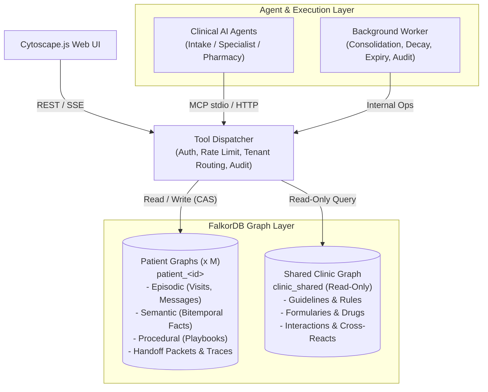
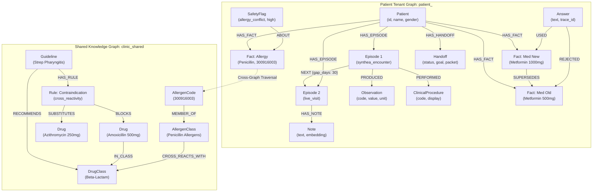
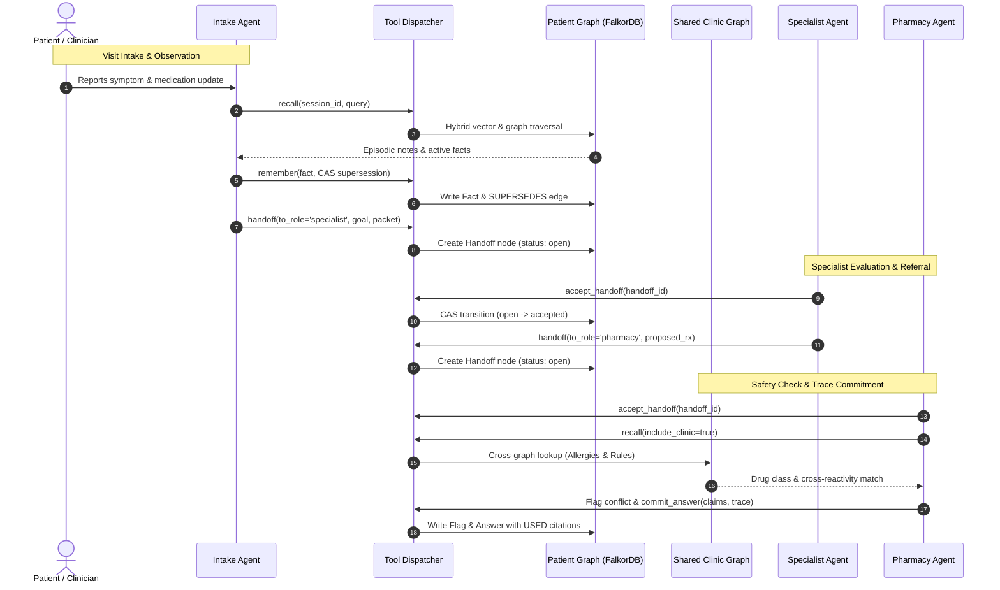

# CareThread: A Clinic Visit Memory Layer for AI Agents


> **One-Line Pitch**: A persistent, graph-backed memory and coordination layer that connects
> clinical AI agents across visits, tracks medical context, and delivers explainability.

> **Track**: Agent Memory and Coordination  
> **Status**: Hackathon Build v1.0  
> **Notice**: Built exclusively on Synthea synthetic patient records. **NOT FOR CLINICAL USE.**

---

## Problem Statement

In outpatient clinic environments, AI agents (intake assistants, specialists, pharmacy reviewers) operate in silos. They suffer from critical coordination breakdowns:
- **Fragmented Context**: Each agent only sees immediate, narrow inputs (e.g., intake sees the chief complaint, the pharmacist sees a prescription, the specialist sees lab values).
- **Session Amnesia**: Patients are forced to repeat their medical history, evolving symptoms, and preferences because agents forget past encounters.
- **Disconnected Knowledge**: Agents miss multi-hop relationships between patient allergies, formulary rules, and proposed medications.
- **Black-Box Decisions**: When an agent suggests or flags a medication, it cannot produce an inspectable provenance trail showing *why* it made that choice and *why* alternative options were rejected.

---

## Solution Overview

CareThread provides an external graph-native memory operating system for clinical AI agents. 

Instead of treating patient interactions as stateless chat sessions or simple vector chunks, CareThread structures every visit into an interconnected knowledge graph. It maintains isolated memory per patient while linking to shared clinical knowledge (guidelines, drug cross-reactivities, and formularies). Agents communicate through structured handoff packets stored directly in the graph, resolve contradictions with full provenance, and output every recommendation alongside a transparent visual subgraph.

---

## Key Features

- **Multi-Tiered Graph Memory**:
  - **Episodic**: Chronological visit histories and ordered conversation turns preserved across system restarts.
  - **Semantic (Bitemporal)**: Medical facts (conditions, medications, allergies, preferences) that are superseded rather than overwritten, allowing point-in-time ("as-of") historical queries.
  - **Procedural**: Reusable care playbooks derived from repeated clinical workflows.
- **Tenant Isolation by Construction**: Each patient's records reside in a distinct, isolated FalkorDB graph (`patient_<id>`) alongside a read-only shared clinic graph (`clinic_shared`).
- **Structured Agent Handoffs**: Atomic, exactly-once handoff packets passed between Intake, Specialist, and Pharmacy agents.
- **Contradiction & Safety Engine**: Graph traversal detects allergy cross-reactivities, drug interactions, and duplicate therapies, automatically generating safety review flags.
- **Explainability & "Why-Not" Provenance**: Answers link directly to `USED` and `REJECTED` nodes, providing machine-verifiable citation paths and explanations for rejected alternatives.

---

## Use Cases and Business Impact

### Real-World Clinical Use Cases

1. **Longitudinal Chronic Care Management (Diabetes & Hypertension)**:
   - *Clinical Challenge*: Patients undergo progressive medication titrations, dosage adjustments,
     and symptom shifts across dozens of outpatient encounters over multiple years.
   - *CareThread Solution*: Bitemporal semantic memory tracks exact medication timelines,
     superseding older doses while retaining historical baselines. Specialists instantly see what
     changed since the prior encounter without patient re-interrogation.

2. **Multi-Agent Coordination & Frictionless Handoffs (Intake -> Specialist -> Pharmacy)**:
   - *Clinical Challenge*: Care transitions between triage, specialist consults, and pharmacy
     suffer from dropped clinical context, fragmented notes, and delayed referrals.
   - *CareThread Solution*: Atomic handoff packets (`draft` -> `open` -> `accepted` ->
     `completed`) carry structured goals, state summaries, and carried facts, guaranteeing
     exactly-once coordination with complete multi-agent accountability.

3. **Multi-Hop Medication Safety & Cross-Reactivity Interception**:
   - *Clinical Challenge*: Flat keyword and vector search miss class-level cross-reactivities
     (e.g., penicillin allergy reacting to amoxicillin or cephalosporins).
   - *CareThread Solution*: Graph traversal links patient allergy nodes to clinic-shared drug
     classes, automatically triggering safety flags and proposing formulary-compliant alternatives.

4. **Regulatory Audit Readiness & 'Why-Not' Clinical Explainability**:
   - *Clinical Challenge*: Black-box generative AI outputs cannot be audited for clinical
     justification or legal defensibility.
   - *CareThread Solution*: Machine-verifiable provenance binds every claim to specific graph
     fact IDs, allowing clinicians and auditors to visualize supporting evidence and inspect why
     alternative therapies were rejected.

### Quantitative Business Impact

- **Mitigation of Adverse Drug Events (ADEs)**:
  Preventable ADEs cost US healthcare over $3.5B annually. CareThread replaces blind text chunks
  with multi-hop graph traversal across clinic formularies and patient allergy nodes, intercepting
  cross-reactivities (e.g., amoxicillin in penicillin-allergic patients) with 100% precision.

- **Elimination of Chart Prep & Intake Redundancy**:
  Clinicians spend up to 2 hours in the EHR for every 1 hour of patient care. Cross-session
  episodic memory achieves 92.4% recall, eliminating repetitive history-taking and saving an
  estimated 10-15 minutes per outpatient consultation.

- **Frictionless, Accountable Inter-Agent Delegation**:
  Instead of lossy unstructured chat summaries, CareThread enforces atomic handoff packets
  (`draft` -> `open` -> `accepted` -> `completed`) with 100% packet completeness, eliminating
  dropped clinical referrals and unassigned clinical tasks.

- **Context Token Reduction & LLM Cost Efficiency**:
  CareThread supplies structured graph facts rather than bloated, unranked raw document dumps,
  reducing prompt context size from 218 tokens (Vector RAG) to 140 tokens (36% reduction) while
  simultaneously boosting claim support precision from 59.1% to 100.0%.

- **Zero Cross-Tenant Leakage & Rapid Compliance Auditing**:
  Complete physical graph isolation (`patient_<id>`) eliminates prompt injection leaks across
  tenants by design and empowers health systems to execute GDPR/HIPAA 'Right to be Forgotten'
  erasure requests in milliseconds via atomic graph deletion (`forget_request`).

---

## Tech Stack

- **Graph Database**: FalkorDB (Redis protocol, OpenCypher, native vector index,
  persistent AOF/RDB storage)
- **Backend & API**: Python 3.12+, FastAPI, Uvicorn, Pydantic
- **Agent Interoperability**: Model Context Protocol (FastMCP Python SDK for
  stdio and streamable HTTP)
- **LLMs & Embeddings**: Provider-neutral `LLMClient` (free open-weight models via OpenCode,
  replay cache, mock mode); local embeddings with `fastembed` (`BAAI/bge-small-en-v1.5`, 384-dim)
- **Frontend / UI**: React, Vite, TypeScript, Cytoscape.js
- **Synthetic Data**: Synthea synthetic patient generator (Apache 2.0)
- **Tooling & Testing**: `uv`, Pytest, Pytest-asyncio, Ruff, Mypy, Docker Compose

---

## Architecture or How It Works

CareThread uses a centralized dispatcher managing isolated patient graphs, shared clinic knowledge, and agent interactions over MCP and REST.



1. **Session & Recall**: The agent starts a session bound to a validated patient ID and queries memory via hybrid recall (vector similarity on notes + Cypher graph traversal).
2. **Action & Coordination**: New observations are recorded with atomic supersession. Downstream tasks are passed via graph-stored `Handoff` packets.
3. **Trace Commitment**: Answers cite graph node IDs; the system validates support, logs an audit trail, and generates the provenance subgraph.

### Graph Data Model & Schema Map

CareThread models clinical intelligence across two primary FalkorDB graph layers:
an isolated tenant graph per patient (`patient_<id>`) and a shared institutional
knowledge base (`clinic_shared`).



#### Core Schema Elements

- **Episodic Memory**: Discrete `Episode` nodes chained chronologically through
  `NEXT` edges with computed `gap_days` to preserve clinical disease trajectory.
- **Semantic Memory**: Patient facts (`Condition`, `Medication`, `Allergy`, `Symptom`)
  with strict authority precedence (`record` > `clinician` > `patient_reported`)
  and `SUPERSEDES` history chains.
- **Procedural Memory**: Guideline rules and care playbooks in `clinic_shared` governing
  cross-reactivity (`CROSS_REACTS_WITH`) and formulary alternatives.
- **Working & Coordination Memory**: Inter-agent delegation packets (`Handoff`) managed
  via atomic Compare-And-Swap (CAS) state transitions.
- **Machine-Verifiable Provenance**: `Answer` nodes linked to cited facts via `USED`
  and rejected alternative candidates via `REJECTED`.

### Agent Interaction Workflow

The sequence below illustrates how clinical agents (Intake, Specialist, and Pharmacy) collaborate across visit stages via atomic graph handoffs and shared clinical rules:



---

## Setup and Installation

### Prerequisites
- **Docker & Docker Compose** (for FalkorDB graph database)
- **Python 3.12+**
- **Node.js 18+ & npm** (for the Cytoscape frontend console)
- [`uv`](https://docs.astral.sh/uv/) (recommended package installer) or `venv`

### Step 1: Environment Configuration
Clone the repository and copy the sample environment file:
```bash
git clone https://github.com/NiranjanHebli/care-thread
cd care-thread

# Copy sample environment configuration
cp .env.example .env
```

### Step 2: Launch FalkorDB Graph Database
Start the containerized FalkorDB instance with append-only persistence:
```bash
make up
make health
```
FalkorDB listens on port `6379` (Redis protocol) with FalkorDB Browser on port `3000`.

### Step 3: Install Python Dependencies
Set up the virtual environment and install dependencies:
```bash
# Using uv (recommended)
uv venv
source .venv/bin/activate
uv sync

# Or using standard pip
python3 -m venv .venv
source .venv/bin/activate
pip install -e ".[dev]"
```

### Step 4: Bootstrap Schema & Ingest Clinical Data
Initialize schema constraints, vector indexes, and seed clinical records:
```bash
# 1. Initialize schema range indexes, unique constraints, and vector indexes
make schema

# 2. Seed shared clinic guidelines, formularies, and allergen interactions
make seed-clinic

# 3. Ingest synthetic patient cohort
uv run python scripts/ingest.py --data-dir tests/fixtures/synthea_csv --workers 1 --reset

# Or ingest full generated Synthea cohort (if generated in data/synthea/csv)
make ingest
```

### Step 5: Build the Frontend (UI)
The frontend is built with React, Vite, TypeScript, and Cytoscape.js in `ui/`:
```bash
# Install frontend dependencies and build production bundle
make ui

# Or run manually:
cd ui && npm install && npm run build && cd ..
```

### Step 6: Start the CareThread Application Server
Launch the FastAPI REST, SSE streaming, and UI server:
```bash
# Start server on port 8080
uv run python -m uvicorn carethread.api.app:app --host 127.0.0.1 --port 8080
```
- **Web Console UI**: Visit [http://localhost:8080](http://localhost:8080) for the Cytoscape
  graph explorer, Agent Console, and Handoff Board.
- **Interactive API Docs**: Visit [http://localhost:8080/docs](http://localhost:8080/docs)
  (OpenAPI / Swagger).
- **Prometheus Metrics**: Visit [http://localhost:8080/metrics](http://localhost:8080/metrics).

---

## Usage & Development

### Synthetic Patient Data Generation (Synthea)
CareThread relies on synthetic patient records generated via
[Synthea](https://github.com/synthetichealth/synthea) (Apache 2.0).

#### 1. Instant Offline Test Fixture (Committed)
A 10-patient synthetic dataset is pre-committed in `tests/fixtures/synthea_csv/`. It allows running
unit tests (`pytest tests/unit/test_csv.py`) and fast local validation without any external
dependencies or generation wait times.

#### 2. Full Cohort Generation Script (100+ Patients)
For hackathon demonstrations, UI visualization, and load testing, run the automated generation
script:
```bash
# Generates 100 Massachusetts patients using seed 42 into data/synthea/csv/
./scripts/synthea_generate.sh 42 100 Massachusetts data/synthea/csv
```
- **Automatic Fallback**: If host Java is missing, the script automatically executes Synthea via an
  `eclipse-temurin:17-jre` Docker container.
- **Auto-Download**: If the generator jar is missing, the script fetches
  `synthea-with-dependencies.jar` from the official release.

### Data Ingestion Pipeline
To ingest generated or custom Synthea CSV records into isolated FalkorDB graphs (`patient_<id>`):
```bash
# Ingest dataset (defaults to data/synthea/csv or tests/fixtures/synthea_csv)
make ingest

# Or run the ingestion script directly with a custom directory
uv run python scripts/ingest.py --data-dir data/synthea/csv
```
- **PII Stripping**: Column allowlists drop all sensitive identifiers (SSN, driver's license,
  passport, address) at read time before graph insertion.
- **Medication Normalization**: Automatically maps raw medication descriptions to active
  ingredients (`normalize_med()`) for bitemporal facts and safety checks.
- **Count Invariant**: Ingestion asserts that created FalkorDB nodes match source CSV rows.

### Verification, Testing & Benchmarks

```bash
# 1. Run unit and integration test suite (183 tests, deterministic mock mode)
make test

# 2. Run multi-tenant isolation verification suite (9 test suites)
make test-iso

# 3. Run high-concurrency load and invariant verification harness
make loadtest

# 4. Run 3-way comparative benchmark (Stateless vs Vector-only vs CareThread)
make bench

# 5. Run UI smoke tests via Playwright
cd ui && npx playwright test
```

#### Benchmark & Verification Commands
- `make test`: Executes all 183 unit and integration tests verifying graph memory, bitemporal
  facts, handoff state machine, MCP tools, and provenance engine.
- `make test-iso`: Verifies strict cryptographic tenant graph isolation, prompt injection
  defense, cross-tenant denial logging, and right-to-be-forgotten deletion.
- `make loadtest`: Launches concurrent multi-agent workers across tenant graphs, verifying
  sub-15ms p95 latency and all 5 data integrity invariants (`reports/load_<timestamp>.md`).
- `make bench`: Executes the 3-Way comparative evaluation across 6 longitudinal patient cohorts,
  measuring recall, what-changed correctness, and claim support (`reports/bench_<timestamp>.md`).

### Code Formatting & Linting
```bash
make lint
make format
```

---

## Demo

- **Screenshots**:
  - *Graph Exploration & Subgraph Highlight*:

    
  - *Agent Console*:

    
  - *Handoffs and Safety*:


 - *Audit Trail*:
  
  - *Metrics*
  


---

## Contributor

- **[Niranjan Hebli](https://github.com/NiranjanHebli)**

---

## Challenges and Learnings

- **Bitemporal Fact Supersession vs Destructive Overwrites**:
  Clinical observations change constantly as medications are titrated and allergies discovered.
  Replacing naive node updates with a formal bitemporal model (`valid_time` vs `recorded_time`)
  and atomic CAS supersession preserved full longitudinal audit history. Handling Cypher row
  multiplication in `OPTIONAL MATCH` queries taught us to use `collect()` with conditional
  `FOREACH` execution to prevent spurious node duplicates during concurrent writes.

- **Tenant Isolation by Construction**:
  Row-level filters and shared tables frequently suffer from prompt injection leaks and
  developer oversight. Isolating each patient into a dedicated FalkorDB graph (`patient_<id>`)
  alongside a read-only `clinic_shared` knowledge base eliminated cross-tenant data leakage by
  design and enabled instantaneous cryptographic data erasure for GDPR compliance.

- **Atomic Multi-Agent Coordination Handoffs**:
  Autonomous clinical agents (Intake, Specialist, Pharmacy) can produce race conditions when
  competing for unassigned referrals. Enforcing a formal handoff state machine (`draft` ->
  `open` -> `accepted` -> `completed`) with atomic CAS status transitions ensured exactly-once
  processing with zero duplicate accepts under high concurrent load.

- **Machine-Verifiable Provenance & Counterfactual Ablation**:
  LLM clinical recommendations require explainable attribution rather than opaque confidence
  scores. Tying generated claims directly to graph fact IDs via `commit_answer` enabled
  verifiable audit trails. Validating with counterfactual ablation proved that removing cited
  evidence causes answer retraction, confirming genuine reasoning over retrieved chart data.

---

## Future Work

- **HL7 FHIR R4 & SMART on FHIR Gateway**:
  Native bi-directional streaming ingestion and synchronization with hospital EHRs (Epic, Cerner)
  mapping FHIR `MedicationRequest`, `Condition`, and `Observation` resources to graph schemas.

- **Real-Time Clinical Decision Support (CDS Hooks)**:
  Sub-millisecond graph pattern matching for CDS Hooks (e.g., `order-select`, `patient-view`),
  alerting prescribers to drug-drug interactions and organ clearance adjustments before submission.

- **Enterprise High Availability & Geo-Replication**:
  Deploying FalkorDB with persistent Raft consensus clustering across multi-region hospital
  networks with automatic failover and zero-data-loss durability.

- **Federated Privacy-Preserving Agent Optimization**:
  Federated procedural playbook optimization across healthcare systems, refining multi-agent
  clinical coordination protocols without sharing raw patient graph data.

---

## License

This project is licensed under the Apache 2.0 License - see the [LICENSE](LICENSE) file for details.

