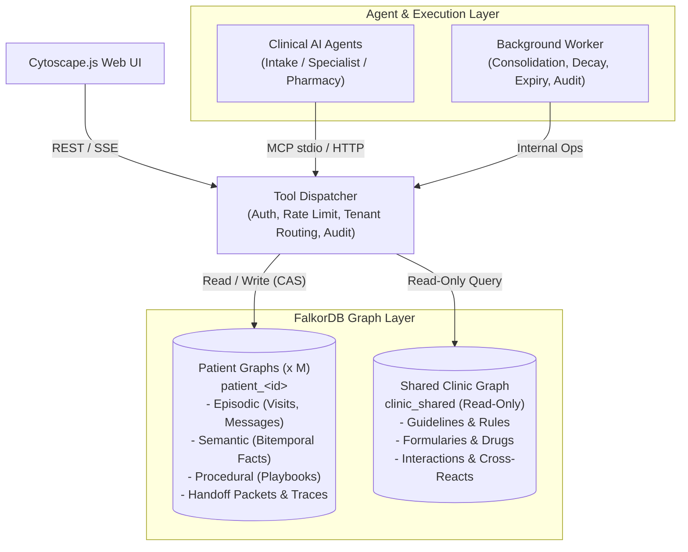
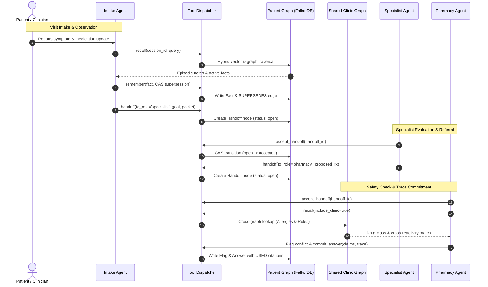

# CareThread: A Clinic Visit Memory Layer for AI Agents

> **One-Line Pitch**: A persistent, graph-backed memory and coordination layer that connects clinical AI agents across visits, tracks medical context over time, and delivers machine-checkable explainability.

> **Track**: Agent Memory and Coordination  
> **Status**: Hackathon Build v1.0  
> **Notice**: Built exclusively on Synthea synthetic patient records. **NOT FOR CLINICAL USE.**

---

## Problem Statement

In outpatient clinic environments, AI agents (intake assistants, specialists, pharmacy reviewers) operate in silos. They suffer from critical coordination breakdowns:
- **Fragmented Context**: Each agent only sees immediate, narrow inputs (e.g., intake sees the chief complaint, the pharmacist sees a prescription, the specialist sees lab values).
- **Session Amnesia**: Patients are forced to repeat their medical history, evolving symptoms, and preferences because agents forget past encounters.
- **Disconnected Knowledge**: Agents miss multi-hop relationships between patient allergies, formulary rules, and proposed medications.
- **Black-Box Decisions**: When an agent suggests or flags a medication, it cannot produce an inspectable provenance trail showing *why* it made that choice and *why* alternative options were rejected.

---

## Solution Overview

CareThread provides an external graph-native memory operating system for clinical AI agents. 

Instead of treating patient interactions as stateless chat sessions or simple vector chunks, CareThread structures every visit into an interconnected knowledge graph. It maintains isolated memory per patient while linking to shared clinical knowledge (guidelines, drug cross-reactivities, and formularies). Agents communicate through structured handoff packets stored directly in the graph, resolve contradictions with full provenance, and output every recommendation alongside a transparent visual subgraph.

---

## Key Features

- **Multi-Tiered Graph Memory**:
  - **Episodic**: Chronological visit histories and ordered conversation turns preserved across system restarts.
  - **Semantic (Bitemporal)**: Medical facts (conditions, medications, allergies, preferences) that are superseded rather than overwritten, allowing point-in-time ("as-of") historical queries.
  - **Procedural**: Reusable care playbooks derived from repeated clinical workflows.
- **Tenant Isolation by Construction**: Each patient's records reside in a distinct, isolated FalkorDB graph (`patient_<id>`) alongside a read-only shared clinic graph (`clinic_shared`).
- **Structured Agent Handoffs**: Atomic, exactly-once handoff packets passed between Intake, Specialist, and Pharmacy agents.
- **Contradiction & Safety Engine**: Graph traversal detects allergy cross-reactivities, drug interactions, and duplicate therapies, automatically generating safety review flags.
- **Explainability & "Why-Not" Provenance**: Answers link directly to `USED` and `REJECTED` nodes, providing machine-verifiable citation paths and explanations for rejected alternatives.

---

## Tech Stack

- **Graph Database**: FalkorDB (Redis protocol, OpenCypher, native vector index, AOF/RDB persistence)
- **Backend & API**: Python 3.12+, FastAPI, Uvicorn, Pydantic
- **Agent Interoperability**: Model Context Protocol (FastMCP Python SDK for stdio & streamable HTTP)
- **LLMs & Embeddings**: Provider-neutral `LLMClient` (free open-weight models via OpenCode, replay cache, and mock deterministic mode); local embeddings with `fastembed` (`BAAI/bge-small-en-v1.5`, 384-dim)
- **Frontend / UI**: React, Vite, TypeScript, Cytoscape.js
- **Synthetic Data**: Synthea synthetic patient generator (Apache 2.0)
- **Tooling & Testing**: `uv`, Pytest, Pytest-asyncio, Ruff, Mypy, Docker Compose

---

## Architecture or How It Works

CareThread uses a centralized dispatcher managing isolated patient graphs, shared clinic knowledge, and agent interactions over MCP and REST.



1. **Session & Recall**: The agent starts a session bound to a validated patient ID and queries memory via hybrid recall (vector similarity on notes + Cypher graph traversal).
2. **Action & Coordination**: New observations are recorded with atomic supersession. Downstream tasks are passed via graph-stored `Handoff` packets.
3. **Trace Commitment**: Answers cite graph node IDs; the system validates support, logs an audit trail, and generates the provenance subgraph.

### Agent Interaction Workflow

The sequence below illustrates how clinical agents (Intake, Specialist, and Pharmacy) collaborate across visit stages via atomic graph handoffs and shared clinical rules:



---

## Setup and Installation

### Prerequisites
- Docker & Docker Compose
- Python 3.12+
- [`uv`](https://docs.astral.sh/uv/) (recommended Python package installer)

### 1. Clone & Setup Environment
```bash
git clone <repository-url>
cd hackathon

# Copy sample environment configuration
cp .env.example .env
```

### 2. Install Dependencies
```bash
uv venv
source .venv/bin/activate
uv sync
```

### 3. Launch FalkorDB
```bash
make up
make health
```

---

## Usage

### Initialize Schema & Data
```bash
# 1. Initialize graph indexes and constraints
make schema

# 2. Ingest synthetic patient history and seed clinic rules
make ingest
make seed-clinic
```

### Synthetic Patient Data Generation (Synthea)
CareThread relies on synthetic patient records generated via [Synthea](https://github.com/synthetichealth/synthea) (Apache 2.0).

#### 1. Instant Offline Test Fixture (Committed)
A 10-patient synthetic dataset is pre-committed in `tests/fixtures/synthea_csv/`. It allows running unit tests (`pytest tests/unit/test_csv.py`) and fast local validation without any external dependencies or generation wait times.

#### 2. Full Cohort Generation Script (100+ Patients)
For hackathon demonstrations, UI visualization, and load testing, run the automated generation script:
```bash
# Generates 100 Massachusetts patients using seed 42 into data/synthea/csv/
./scripts/synthea_generate.sh 42 100 Massachusetts data/synthea/csv
```
- **Automatic Fallback**: If host Java is missing, the script automatically executes Synthea via an `eclipse-temurin:17-jre` Docker container.
- **Auto-Download**: If the generator jar is missing, the script fetches `synthea-with-dependencies.jar` from the official release.

### Data Ingestion Pipeline
To ingest generated or custom Synthea CSV records into isolated FalkorDB graphs (`patient_<id>`):
```bash
# Ingest dataset (defaults to data/synthea/csv or tests/fixtures/synthea_csv)
make ingest

# Or run the ingestion script directly with a custom directory
uv run python scripts/ingest.py --data-dir data/synthea/csv
```
- **PII Stripping (TR-ING-01)**: Column allowlists drop all sensitive identifiers (SSN, driver's license, passport, address) at read time before graph insertion.
- **Medication Normalization (TR-ING-03)**: Automatically maps raw medication descriptions to active ingredients (`normalize_med()`) for bitemporal facts and safety checks.
- **Count Invariant (TR-ING-05)**: Ingestion asserts that created FalkorDB nodes match source CSV rows.


### Run Tests
```bash
# Run unit and integration tests (uses deterministic mock mode)
make test

# Run tenant isolation test suite
make test-iso
```

### Code Formatting & Linting
```bash
make lint
make format
```

---

## Demo

- **Video Walkthrough**: [TODO: add demo video link]
- **Live Demo / Deployment**: [TODO: add live URL if hosted]
- **Screenshots**:
  - *Graph Exploration & Subgraph Highlight*: [TODO: add screenshot]
  - *Agent Handoff Board & Flags*: [TODO: add screenshot]
  - *"Why-Not" Provenance Drawer*: [TODO: add screenshot]

---

## Team

- **[TODO: Member Name]** - [TODO: Role / Contributions]
- **[TODO: Member Name]** - [TODO: Role / Contributions]

---

## Challenges and Learnings

- [TODO: Challenges and key learnings faced during implementation]

---

## Future Work

- [TODO: Future improvements and planned features]

---

## License

[TODO: add license type, e.g., Apache-2.0 / MIT]
